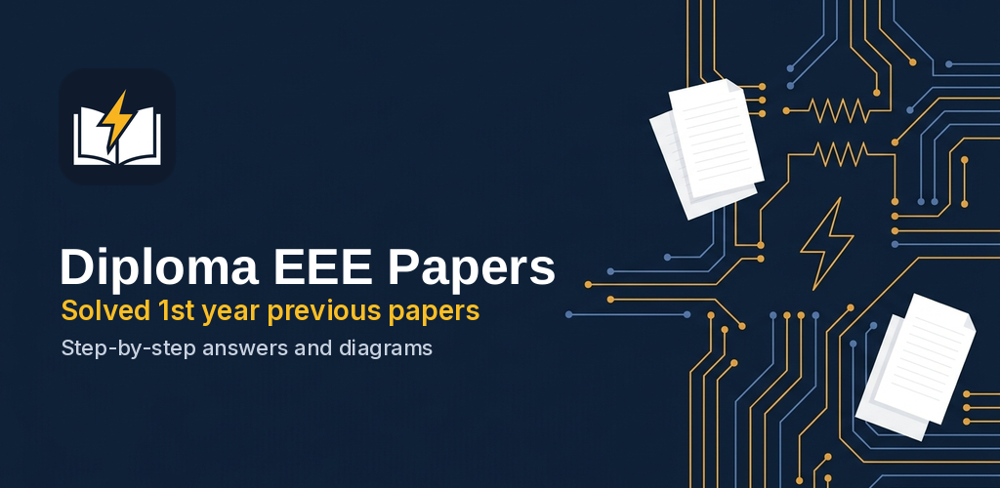
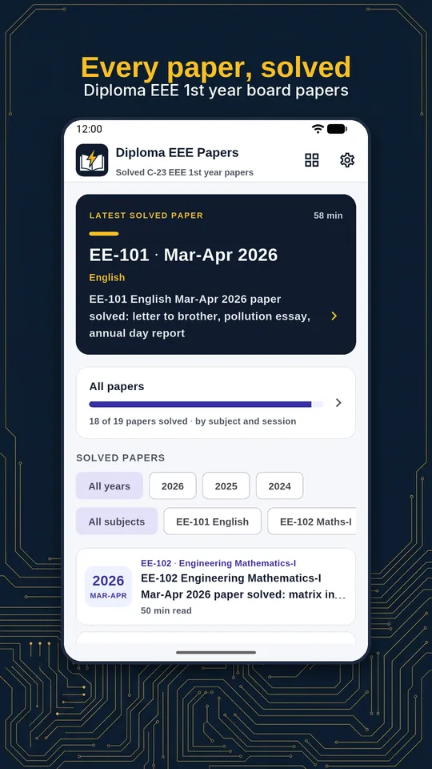
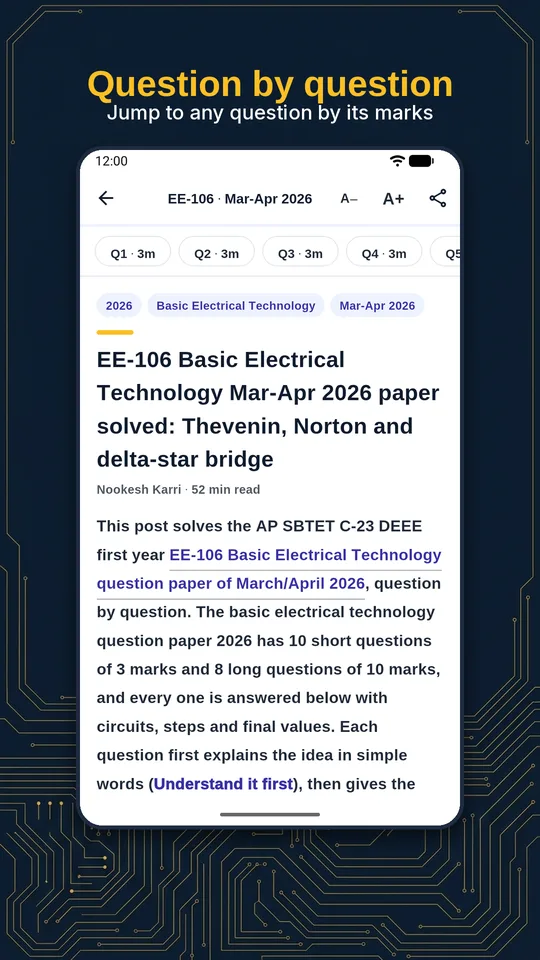
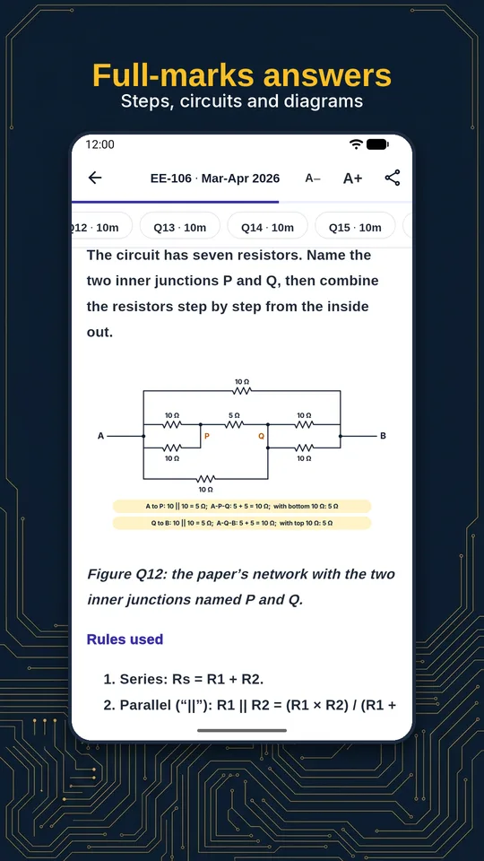
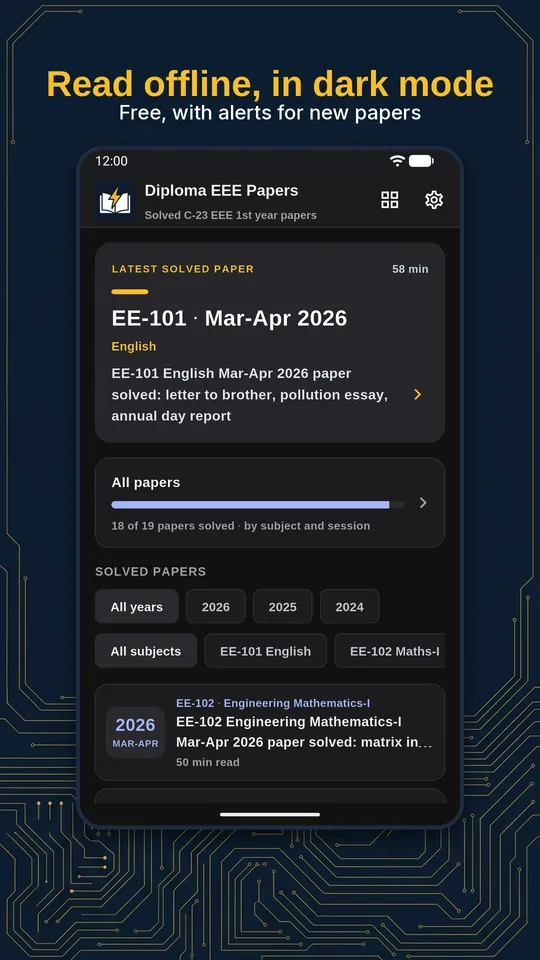

# Diploma EEE 1st Year Papers

Diploma EEE Papers is a free Android app with the AP SBTET C-23 diploma EEE first year previous question papers, solved question by question: the theory explained simply first, then a full-marks model answer with steps, circuits and diagrams.

<a href="https://play.google.com/store/apps/details?id=com.exambadi.sbteteee&utm_source=github&utm_medium=readme"><b>Get it on Google Play</b></a> · <a href="https://sbtet-eee.exambadi.in/">Website</a> · <a href="https://nookeshkarri7.github.io/diploma-eee-papers/">About page</a>

## What's inside

- **All seven first year subjects.** English, Engineering Mathematics-I, Engineering Physics, Engineering Chemistry & Environmental Studies, Electrical Engineering Material Science, Basic Electrical Technology and Engineering Drawing.
- **Real board papers.** March/April and October/November sessions, each question exactly as printed with its marks.
- **Understand it first.** The idea behind every question in short, simple sentences.
- **Exam answer.** A model answer with one point per mark, so you know how much to write.
- **Circuits and drawings.** Diagrams, graphs and drawing constructions with every value labelled.
- **Works offline.** Papers you opened stay on your phone. Text size, light and dark themes, and an optional alert when a new paper is solved.

Free, no sign-in. The app shows ads, never inside an answer.

Diploma EEE Papers is an independent study app, not affiliated with SBTET Andhra Pradesh or any government body. Official site: https://sbtet.ap.gov.in

## Links

- Google Play: https://play.google.com/store/apps/details?id=com.exambadi.sbteteee
- Website: https://sbtet-eee.exambadi.in/
- Privacy policy: https://sbtet-eee.exambadi.in/app/privacy/
- Teaser: https://youtu.be/Eu9oK5q79L4

© 2026 NK Tools
